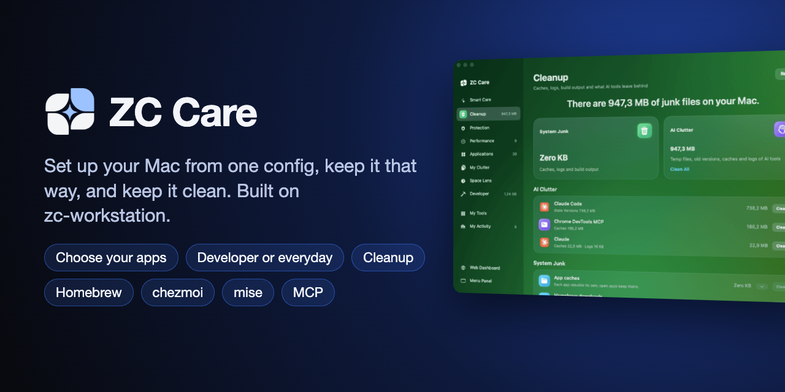
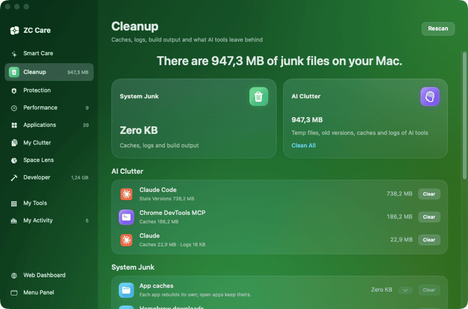
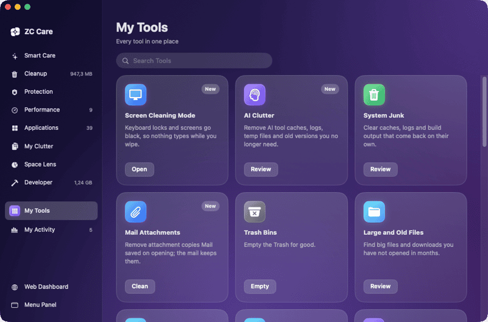
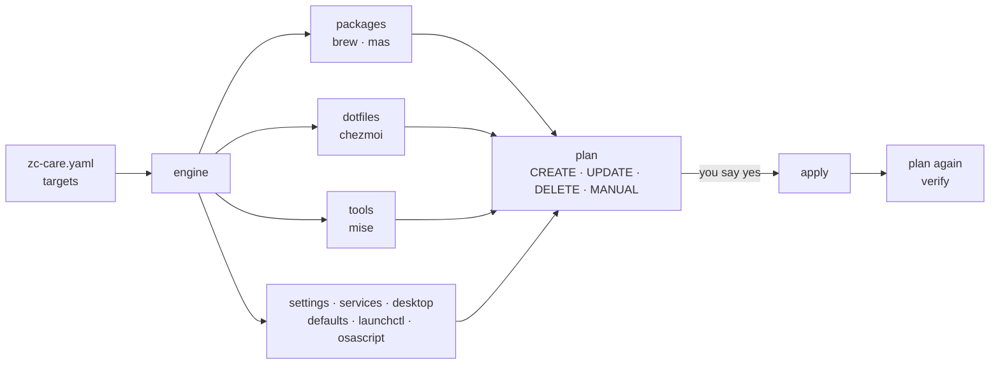

<p align="center">
  
</p>

# ZC Care

[](https://github.com/ZoolCoder/zc-care/releases/latest)
[](https://github.com/ZoolCoder/zc-care/releases)
[](https://github.com/ZoolCoder/zc-care/actions/workflows/ci.yml)
[](https://zoolcoder.github.io/zc-care/)
[](LICENSE)
[](go.mod)


**Set up your Mac from one config, keep it that way, and keep it clean.**

ZC Care is a Mac app. On a new Mac it asks who the Mac is for, a developer
or everyday use, and installs the apps you pick. After that it shows what
is missing or out of date and puts it right when you say so. It also
cleans junk, uninstalls apps with their leftovers and watches the Mac's
health.

```console
$ brew tap zoolcoder/zc-care https://github.com/zoolcoder/zc-care
$ brew trust zoolcoder/zc-care    # newer Homebrew loads a third-party tap only once you trust it
$ brew install --cask zc-care
```

Free and open source, MIT. macOS 14 or later.

<p align="center">
  
</p>

Under it runs **zc-care**, a command-line engine that manages the
whole setup of the Mac:

- Homebrew formulae and casks, and Mac App Store apps
- dotfiles, through chezmoi
- language runtimes, through mise
- macOS settings and background services
- the wallpaper and screen saver

The engine reads what the machine has and shows you the difference as a
plan. Only if you say so does it close the gap. Then it reads the machine
again to prove the change took. ZC Care, the terminal and AI agents all go
through it.

Think `terraform plan` and `terraform apply`, for your laptop.

```console
$ zc-care plan
CREATE  brew      cask:ghostty              install with brew
CREATE  brew      brew:lazygit              install with brew
UPDATE  dotfiles  .gitconfig                update; changed outside chezmoi, apply overwrites it
CREATE  runtimes  java@temurin-25           install with mise
CREATE  macos     com.apple.dock autohide   set to true

$ zc-care apply
done  CREATE brew cask:ghostty
done  CREATE brew brew:lazygit
...
applied and verified
```

## Contents

- [ZC Care](#zc-care)
- [Who it is for](#who-it-is-for)
- [Why](#why)
- [How it works](#how-it-works)
- [Quick start](#quick-start)
- [The config](#the-config)
- [Commands](#commands)
- [Everyday workflows](#everyday-workflows)
- [The toolbox](#the-toolbox)
- [AI agents](#ai-agents)
- [Safety](#safety)
- [How it compares](#how-it-compares)
- [Project layout](#project-layout)
- [Status and roadmap](#status-and-roadmap)
- [Contributing](#contributing)

## ZC Care

ZC Care lives in the menu bar. Press ⌃⌥Z or click the mark to open its
panel, which has five tabs:

- **Mac:** live disk, memory, CPU, battery, network and sensors.
- **Overview:** each target, with *Apply*.
- **Updates:** macOS updates and outdated packages, with *Update All*.
- **Health:** `doctor` findings, with *Fix*.
- **Services:** with *Start* and their logs.

*Smart Care* in the panel opens the Care window, for looking after the Mac.
It has these modules:

| Module | Does |
|---|---|
| Smart Care | Scans everything at once and cleans up in one click. |
| Cleanup | Clears caches, logs, build output and Mail downloads. Clears what AI tools leave behind: Claude Code temp files and old versions, and the caches of Claude, Cursor, ChatGPT, Windsurf, Codex and Gemini CLI. |
| Protection | Shows Gatekeeper's verdict per app, background apps (newly appeared ones marked), extensions (Safari, Finder, Share, Quick Look, Spotlight and system extensions, with their host app and state) and privacy permissions. |
| Performance | Manages login items and runs maintenance: free RAM, flush DNS, thin snapshots, reindex Spotlight. Top processes by CPU or memory, with *Quit* and *Force Quit*. |
| Applications | Uninstalls apps with their leftovers. *Adopt* moves an app installed by hand to Homebrew. |
| My Clutter, Space Lens | Find large and duplicate files, old downloads and installers, and map what fills your disk. Space Lens keeps the previous scan, marks folders that grew and links them to the module that can clean them. |
| Cloud Cleanup | Lists the files iCloud Drive keeps downloaded on the Mac. *Remove Download* frees the space and keeps the file in iCloud. Google Drive, OneDrive and Dropbox are counted, and their folders open in Finder. |
| Developer | Finds `node_modules` and virtualenvs of projects idle for 90 days, and local AI models. Shows what Docker keeps, with Prune Build Cache and Prune Dangling Images (permanent), and Xcode's DerivedData, Archives, DeviceSupport and simulator caches. Simulator runtimes, with *Delete* (permanent), and Android system images and AVDs. |
| My Workstation | What your config declares and what is in place: coverage, each target with *Apply*, every item to search, and what was applied. What this Mac has that the config does not name, with *Add to Config…*. *Choose Apps…* opens the app picker. |
| My Tools, My Activity | Give every tool in one grid, Mac health, and what ZC Care has freed so far. |

<p>
  
  
</p>

Every change ZC Care makes asks first:

- Caches, browser data, AI clutter, files, apps and leftovers go to the Trash
  by default, and My Activity can put them back. A Settings toggle deletes
  permanently instead. Docker's prune buttons always delete for good.
- A Homebrew app is uninstalled through `zc-care remove`, so it also
  leaves the Brewfile.

ZC Care never touches AI chats and sessions, the Claude Code version in use,
or the caches of open apps.

```console
$ brew tap zoolcoder/zc-care https://github.com/zoolcoder/zc-care
$ brew trust zoolcoder/zc-care    # newer Homebrew loads a third-party tap only once you trust it
$ brew install --cask zc-care    # or make app-install in a clone (macOS 14+)
```

More is in [app/README.md](app/README.md) and the manual's
[Menu bar app and ZC Care](https://zoolcoder.github.io/zc-care/app.html) page.

## Who it is for

The first time it runs, ZC Care opens **Choose Apps**. You pick who the Mac
is for, then untick what it does not need:

- **Developer:** runtimes, git tools, containers, databases and cloud CLIs,
  on top of everything else.
- **Everyday:** the terminal, apps and desktop setup, plus AI apps, without
  the developer toolchain.
- **Everything:** every package the config declares.

The profiles come from the Brewfile's section headings. A tag in brackets
names who a section is for; a section without one is for everyone:

```ruby
# Containers [developer]
brew "colima"
# AI [developer, everyday]
cask "claude"
# Apps
cask "google-chrome"
```

What you leave out goes on this Mac's skip list, so plan and drift stop
asking for it. The config stays as it is, ready for the next Mac. After the
install, ZC Care shows the first keys and commands to try with each app.
*Choose Apps…* in My Workstation or Settings opens the picker again;
`zc-care skip` changes the list from a terminal.

## Why

A developer machine is usually set up by:

- a `Brewfile`
- a dotfiles repo
- a `.tool-versions` or `mise.toml`
- a long `install.sh` full of `defaults write` lines

Each of these works alone, but nothing tells you how far the machine has
drifted from them. You find out when a new laptop is missing half your
tools, or when `install.sh` runs over a file you edited by hand.

zc-care puts one plan over all of them:

- **One view of the gap.** One command shows every package, dotfile, runtime
  and setting that is missing or different. It changes nothing while it
  looks.
- **Changes you review.** You see each action before it runs. A saved plan
  applies exactly what you reviewed, and nothing if the machine moved on.
- **Proof, not hope.** After every apply, it plans again. If a change ran
  but did not take, it says so and does not call it done.
- **The tools you already use.** It drives `brew`, `chezmoi`, `mise`,
  `defaults` and `launchctl`, and does not reimplement them. Your Brewfile
  and dotfiles stay plain files that work without it.
- **One OS, done well.** It is built for macOS only, so every provider
  speaks the Mac's own tools and nothing is half supported.

## How it works



1. **Config.** The config is a list of *targets*. Each target names:
   - a *provider*, such as `packages`, `dotfiles` or `tools`
   - the file it manages, such as a Brewfile, a chezmoi source or a
     `mise.toml`
   - optionally, the systems it is for

   Relative paths resolve against the config file, so the same file works on
   every machine you clone it to.
2. **Read.** For each target on this system, the engine asks its provider
   what the machine has. Targets are read in parallel. A provider only
   reads; any write it would make is held inside an action.
3. **Plan.** Each difference becomes an action. Four kinds:

   | Action | Meaning |
   |---|---|
   | `CREATE` | Something declared is missing: install it, write it, start it. |
   | `UPDATE` | Something is there but differs: a changed dotfile, a wrong setting, an upgrade you asked for. |
   | `DELETE` | Something must go. Always needs a person's yes. |
   | `MANUAL` | Something no tool should do for you, like installing Homebrew itself or trusting a mise config. The plan says what to run, for example `mise does not trust mise.toml; review it, then run mise trust mise.toml`. |

4. **Apply.** The actions run in order. If one fails, it is reported and the
   rest still run, so one broken package does not block the others.
5. **Verify.** The engine plans again from scratch. If anything is left, the
   apply did not converge, and the tool says so and exits non-zero.

**Saved plans** pin what you reviewed:

```console
$ zc-care plan -out plan.json     # review this
$ zc-care apply plan.json         # applies exactly it
the live state changed since this plan was saved: ... re-run plan
```

On apply, it plans again and compares. It refuses if anything moved since you
reviewed the plan.

**Exit codes** make it scriptable:

| Code | Meaning |
|---|---|
| `0` | Nothing to do, or the apply converged and was verified. |
| `1` | Something failed. |
| `2` | With `-exit-code`: changes are outstanding. |
| `3` | With `-exit-code`: only `MANUAL` items are left. |

`plan`, `status` and `list` also take `-json`.

## Quick start

**1. Install.** ZC Care carries the CLI, and its cask puts
`zc-care` on PATH:

```console
$ brew tap zoolcoder/zc-care https://github.com/zoolcoder/zc-care
$ brew trust zoolcoder/zc-care    # newer Homebrew loads a third-party tap only once you trust it
$ brew install --cask zc-care
```

To build the CLI alone, use `go install` or `make install` in a clone,
which puts it in `~/.local/bin` (Go 1.26+):

```console
$ go install github.com/zoolcoder/zc-care/cmd/zc-care@latest
```

**2. Write a config.** Start from the example, and point its paths at your
own Brewfile, dotfiles and `mise.toml`:

```console
$ mkdir -p ~/.config/zc-care
$ cp zc-care.example.yaml ~/.config/zc-care/zc-care.yaml
$ zc-care validate     # offline check of the config
```

Already have a set-up machine? `capture` writes its manifest for you:

```console
$ zc-care capture -target brew -out Brewfile
```

**3. Check the machine.**

```console
$ zc-care doctor
ok    system                       macbook darwin/arm64
ok    config                       ~/.config/zc-care/zc-care.yaml, 7 target(s)
ok    program brew                 /opt/homebrew/bin/brew
ok    program chezmoi              /opt/homebrew/bin/chezmoi
ok    program mise                 /opt/homebrew/bin/mise
warn  target brew                  78 of 80 packages installed (brew)
ok    security FileVault disk encryption
warn  security servers on every network interface   node:3000; bind dev servers to 127.0.0.1
```

**4. Plan, then apply.**

```console
$ zc-care plan
$ zc-care apply
```

**5. See where things stand.**

```console
$ zc-care status
packages  121 of 121 packages installed (brew)
home      36 of 36 dotfiles in place
runtimes  9 of 9 tools installed
look      wallpaper in place, screensaver in place, accent in place
macos     26 of 26 settings in place
services  6 of 6 services running
```

### A new Mac in one command

Keep your config in its own repo, which can be private. Then, on a fresh Mac:

```console
$ curl -fsSL https://raw.githubusercontent.com/ZoolCoder/zc-care/main/bootstrap.sh | bash -s -- OWNER/CONFIG-REPO
```

The script:

1. Installs Homebrew, which brings the Xcode command line tools.
2. Installs git, gh, chezmoi and mise.
3. Logs you in to GitHub.
4. Clones zc-care and your config repo.
5. Installs ZC Care, which carries the CLI.
6. Trusts your `mise.toml`.
7. Opens **Choose Apps** in ZC Care, so you pick what this Mac
   gets. `ZC_NO_PICKER=1` skips the picker; apply then plans everything and asks once.
8. Plans and applies until nothing is left.

It is safe to run again. The manual's
[A new Mac in one command](https://zoolcoder.github.io/zc-care/new-machine.html)
page shows a config repo layout that works well.

## The config

```yaml
version: 1
targets:
  - name: brew
    provider: packages
    file: packages/Brewfile
    # upgrade: true          # also plan upgrades for outdated packages

  - name: dotfiles
    provider: dotfiles
    source: home              # a chezmoi source directory
    mode: symlink             # edits to ~/.zshrc land in the repo

  - name: runtimes
    provider: tools
    file: mise.toml

  - name: macos
    provider: settings
    defaults:
      com.apple.dock: {autohide: true}
      NSGlobalDomain: {KeyRepeat: 2}

  - name: services
    provider: services
    services: [colima]

  - name: look
    provider: desktop
    wallpaper: assets/wallpaper/zc-care-laptop-dark.png
    accent: blue
```

| Provider   | Manages                                    | Through |
|------------|--------------------------------------------|---------|
| `packages` | A Brewfile, App Store apps included        | `brew`, `mas` |
| `dotfiles` | A chezmoi source directory, applied path by path | [chezmoi](https://www.chezmoi.io) |
| `tools`    | The runtimes a mise config pins            | [mise](https://mise.jdx.dev) |
| `settings` | macOS preferences                          | `defaults` |
| `services` | Homebrew services and launchd agents       | `brew services`, `launchctl` |
| `desktop`  | Wallpaper on every Space, screen saver, accent colour | `osascript`, [WebViewScreenSaver](https://github.com/liquidx/webviewscreensaver) |
| `localdir` | Files written inline in the config         | direct writes inside one directory |

The config is found in this order:

1. `-config`
2. `$ZC_CARE_CONFIG`
3. `./zc-care.yaml`
4. `~/.config/zc-care/zc-care.yaml`

Every key is in [Writing a config](https://zoolcoder.github.io/zc-care/configuration.html).

A comment after a Brewfile line is the item's *why*. `list` and ZC Care
show it, so the manifest also records why each tool is there:

```ruby
cask "ghostty"   # terminal: fast, native, GPU-rendered
brew "lazygit"   # git TUI for staging hunks
```

## Commands

| Command | Does |
|---|---|
| `plan` | Shows what would change. It is the default command and writes nothing. |
| `apply [file]` | Makes the changes, then verifies them. Given a saved plan, it applies exactly that plan. |
| `status` | Gives a one-line summary per target of what is in place now. |
| `list` | Lists every package, app, dotfile and runtime, with its version, state and why. |
| `add -target t -why w kind:name` | Declares an item in a target's manifest, under the right section. The next apply installs it. |
| `remove -target t kind:name` | Plans the uninstall, shows it and drops the item from the manifest after you confirm. Agents only get the plan. |
| `capture -target t` | Writes a target's manifest from what this machine has. |
| `validate` | Checks the config offline, and agents manifests for bad `${keychain:...}` references. |
| `export [-o file]` | Saves what this Mac has, per target, as a JSON snapshot without secrets. |
| `diff a.json [b.json]` | Shows what differs between two snapshots, or one and this Mac. |
| `doctor [-fix]` | Checks programs, config, targets and macOS security settings, each with its fix. With `-fix` it plans those fixes, lists the exact commands and runs them after a yes. |
| `undo [-n N] [-plan]` | Plans the reverse of the last apply (settings, dotfiles, packages), shows it and runs it after a yes. |
| `init -profile p [-role r] [-from-mac]` | Writes a starter config for this Mac and installs nothing. `-list` shows the profiles. |
| `profile [name...]` | Shows or sets who this Mac is for; targets with `profiles` follow it. `-clear` drops them. |
| `skip [-undo] kind:name` | Lists or changes the packages this machine leaves out. |
| `history [-n N]` | Shows what was applied, newest first. |
| `drift [-last] [-plist]` | Counts what differs from the config and saves it; `-plist` prints a launchd agent that runs it each morning. |
| `mcp` | Starts the MCP server for AI agents, over stdio. |

Useful flags:

| Flag | Does |
|---|---|
| `-target t` | Works on one target. Repeat it for several. |
| `-only brew:tmux` | Plans or applies a single change. |
| `-upgrade` | Also plans upgrades for outdated packages and runtimes. |
| `-out plan.json` | Saves the plan, to apply exactly what you reviewed. |
| `-state outdated,"not declared"` | Filters `list` by state. |
| `-kind cask,brew` | Filters `list` by kind. |
| `-exit-code` | Makes the exit code report outstanding changes. |
| `-json` | Gives machine-readable output, on `plan`, `status`, `list`, `apply`, `validate`, `doctor`, `diff`, `undo`, `history`, `drift`, `init`, `profile` and `skip`. |

The full reference is in [Commands](https://zoolcoder.github.io/zc-care/commands.html).

## Everyday workflows

**Install something new.** Declare it, so the next machine gets it too:

```console
$ zc-care add -target brew -section Git -why "stage hunks from the terminal" brew:lazygit
$ zc-care apply -only brew:lazygit
```

**Find drift.** Some things are outdated, and some were installed by hand
and never declared. To list both:

```console
$ zc-care list -state outdated,"not declared"
```

**Upgrade on your terms.** Upgrades are never automatic. Plan them, review,
apply:

```console
$ zc-care plan -upgrade -target brew
$ zc-care apply -upgrade -target brew
```

**Keep two Macs in step.** Commit the config repo on one and pull on the
other. Then run `zc-care plan` to see what the second machine is
missing.

**Uninstall cleanly.** `remove` uninstalls the item and takes it out of the
manifest. The next plan then does not reinstall it.

**`sudo`.** Some installs need `sudo`. They ask for your password in the
terminal, or in a macOS dialog when there is no terminal. The password goes
straight to `sudo` and is never stored or shown to an agent.

## The toolbox

zc-care was built to run one developer's Mac, and the manual
describes that setup tool by tool: what each is for, how it is configured,
and the keys worth knowing. Take what you like into your own Brewfile.

| Area | Tools |
|---|---|
| Terminal and shell | [Ghostty](https://zoolcoder.github.io/zc-care/toolbox/ghostty.html), [tmux](https://zoolcoder.github.io/zc-care/toolbox/tmux.html) with a `dev` layout, zsh with antidote, Starship, Atuin |
| Command line | fzf, zoxide, eza, bat, fd, ripgrep, Yazi |
| Git | lazygit, delta, difftastic, git-absorb, gitleaks before every commit, gh |
| Runtimes and dotfiles | mise, chezmoi, direnv |
| Containers and data | Colima and Docker, lazydocker, k9s, PostgreSQL 17, pgcli, TablePlus |
| Desktop | SketchyBar and JankyBorders, Karabiner with a Hyper key, Raycast, Chrome |
| Editors | VS Code, IntelliJ IDEA, Neovim |
| AI | Claude Code in a Ghostty split or a tmux pane, Codex, CodexBar, Ollama |

The colours, prompt, terminal and bar themes are in [`assets/theme`](assets/theme).
Start at [The toolbox](https://zoolcoder.github.io/zc-care/toolbox/index.html).

## AI agents

`zc-care mcp` is an MCP server. It gives an agent `plan`, `apply`,
`status`, `list`, `add`, `remove`, `capture`, `doctor`, `validate`, `history` and `drift`. The
rules are the same as in the terminal:

- **Apply takes only a plan id.** An agent can apply a plan it saved, after
  you said yes to it. It can never apply a plan body it wrote.
- **One config.** The server uses its own config; no tool takes a config
  path, and a saved plan from another config is refused.
- **Deletes stay with you.** A plan that deletes anything goes back to your
  terminal.
- **Installer output stays out.** It never reaches the protocol stream.

The repo is also a **Claude Code plugin**, which brings the MCP server and
these skills:

- `setup`: install, config, doctor
- `plan-apply`: plan, explain, apply
- `add-software`: declare a tool instead of running `brew install`
- `review`: what is new, what to fix

```console
$ claude plugin marketplace add zoolcoder/zc-care
$ claude plugin install zc-care
```

There are also adapters for **Codex, Gemini, Copilot and Cursor** in
[`plugin/adapters/`](plugin/adapters). The manual's
[Agents and MCP](https://zoolcoder.github.io/zc-care/agents.html)
page covers the setup.

## Safety

- **Planning writes nothing.** Every write lives inside an action, and an
  action runs only on apply.
- **Nothing is applied that was not shown.** A saved plan refuses to run if
  the machine changed since. The dotfiles provider applies only the paths in
  the plan.
- **Nothing is uninstalled, nothing is upgraded, unless you ask.**
  `packages` only installs. Upgrades are opt-in per target, or per run with
  `-upgrade`.
- **Deletions need a person.** The CLI and ZC Care ask, and the MCP server
  refuses.
- **Untrusted stays untrusted.** Trusting a mise config is a `MANUAL` step,
  never automatic.
- **Writes stay inside their target.** `localdir` writes through `os.Root`,
  so neither a symlink nor `..` can escape.
- **No telemetry, no account, no cloud service.**

The [threat model](https://zoolcoder.github.io/zc-care/security.html)
says what it protects against and what it does not.

## How it compares

| | zc-care | `brew bundle` | chezmoi alone | Ansible | Nix / home-manager |
|---|---|---|---|---|---|
| Packages, dotfiles, runtimes, settings in one plan | yes | packages only | dotfiles only | yes | yes |
| Shows the plan before changing anything | yes | no | `chezmoi diff` | `--check` | build first |
| Verifies after apply | yes, plans again | no | no | no | yes |
| Uses your existing Brewfile, chezmoi source, mise config | yes | yes | yes | no | no |
| Mac app, MCP for agents | yes | no | no | no | no |
| Learning curve | one YAML file | none | small | large | large |

zc-care is for one person's Macs. It is not for fleets of
servers; that is Ansible's job.

## Project layout

```text
app/                  ZC Care, the SwiftUI app (ZCCareCore holds the tested logic)
cmd/zc-care/          the CLI: plan, apply, list, add, remove, capture, skip, doctor, mcp
internal/engine/      config + providers -> one plan; apply, then plan again to verify
internal/provider/    packages, dotfiles, tools, settings, services, desktop, agents, localdir
internal/plan/        actions, saved plans and their freshness check
internal/config/      the YAML config and its validation
plugin/               the Claude Code plugin: skills, commands, hooks, evals
plugin/adapters/      instructions for Codex, Gemini, Copilot, Cursor and cloud agents
Casks/                the Homebrew cask, so this repository is also the tap
assets/               the ZoolCoder theme, wallpaper and screen saver
docs/                 the Antora manual
bootstrap.sh          a new Mac in one command
```

## Status and roadmap

ZC Care is macOS only, on purpose: one system is easier to get right and
to keep right. The engine replaced an ~850-line shell setup.

Next up are Similar Images in ZC Care and a notarised ZC Care. See the
[roadmap](docs/ROADMAP.md), the concrete tasks in [TODO.md](TODO.md), and
the [changelog](CHANGELOG.md).

## Contributing

```console
$ make lint test build    # the CLI: gofmt, vet, golangci-lint, tests, bin/zc-care
$ make app-test app       # ZC Care, on macOS
$ make docs               # the manual, which must build with no warnings
```

Tests never touch the network, and CI runs them on macOS. The project follows git flow: branch from `develop` and open your
pull request against it.

- [CONTRIBUTING.md](CONTRIBUTING.md): set up, branches, commits, what a good
  change looks like.
- [TODO.md](TODO.md): open work, with *good first change* items.
- [Adding a provider](https://zoolcoder.github.io/zc-care/extending.html).
- [GOVERNANCE.md](GOVERNANCE.md): who decides, and how releases work.

Questions go to [SUPPORT.md](SUPPORT.md). Security reports go to
[SECURITY.md](SECURITY.md), never to a public issue.

## License

[MIT](LICENSE)
